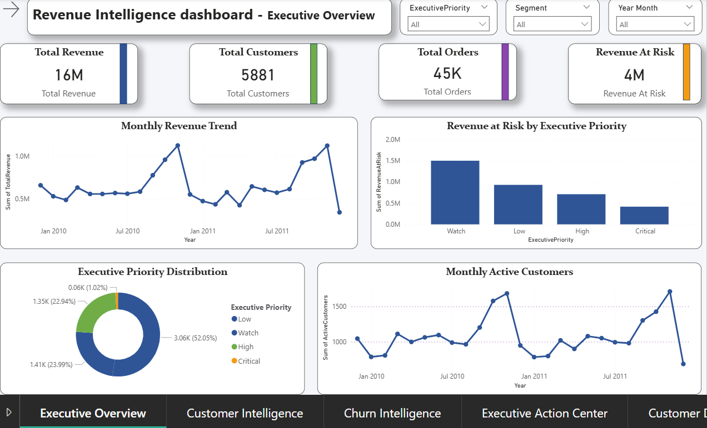
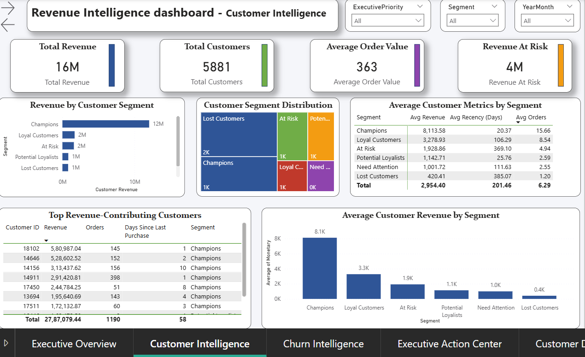
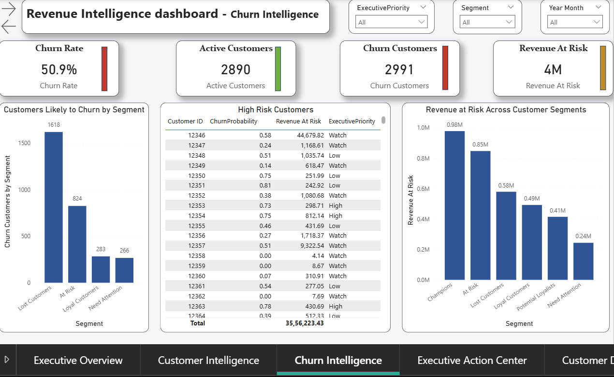
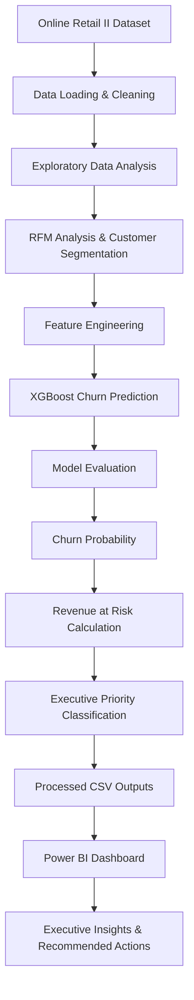

# Revenue-Intelligence-Dashboard
End-to-End Data Analytics &amp; Machine Learning Project using Python, XGBoost and Power BI to predict customer churn, estimate revenue at risk and generate executive business insights.

## Dataset

This project uses the **Online Retail II** dataset from the UCI Machine Learning Repository.

- **Source:** [UCI Online Retail II Dataset](https://archive.ics.uci.edu/dataset/502/online+retail+ii)
- **Original file:** `online_retail_II.xlsx`
- **Records:** 1,067,371 transactions
- **Period:** December 2009 – December 2011
- **License:** Creative Commons Attribution 4.0 (CC BY 4.0)

The original dataset is not included in this repository because of its file size. Please download it from the official source above before running the notebooks.

**Citation:** Chen, D. (2012). Online Retail II [Dataset]. UCI Machine Learning Repository. https://doi.org/10.24432/C5CG6D

## Dashboard Preview

### 1. Executive Overview

### 2. Customer Intelligence

### 3. Churn Intelligence

### 4. Executive Action Center

## Project Architecture

The project follows an end-to-end analytics workflow, starting with raw transaction data and ending with actionable business insights.

## Project Workflow

### 1. Data Preparation
- Loaded and cleaned the Online Retail II transaction dataset.
- Handled missing values and prepared customer-level data.
- Created analytical datasets for further processing.

### 2. Customer Analytics
- Performed Exploratory Data Analysis (EDA).
- Conducted RFM analysis.
- Identified customer segments and purchasing patterns.
- Performed cohort analysis.

### 3. Machine Learning
- Engineered customer-level features.
- Prepared training and testing datasets.
- Developed an XGBoost classification model.
- Evaluated performance using Accuracy, Precision, Recall, F1-score and ROC-AUC.

### 4. Revenue at Risk
- Generated customer-level churn probabilities.
- Estimated revenue at risk.
- Classified customers into executive priority levels.
- Prepared actionable customer-level outputs.

### 5. Power BI Dashboard
- Connected the processed datasets to Power BI.
- Created DAX measures and interactive visualizations.
- Developed four dashboard pages for executive reporting and decision-making.
