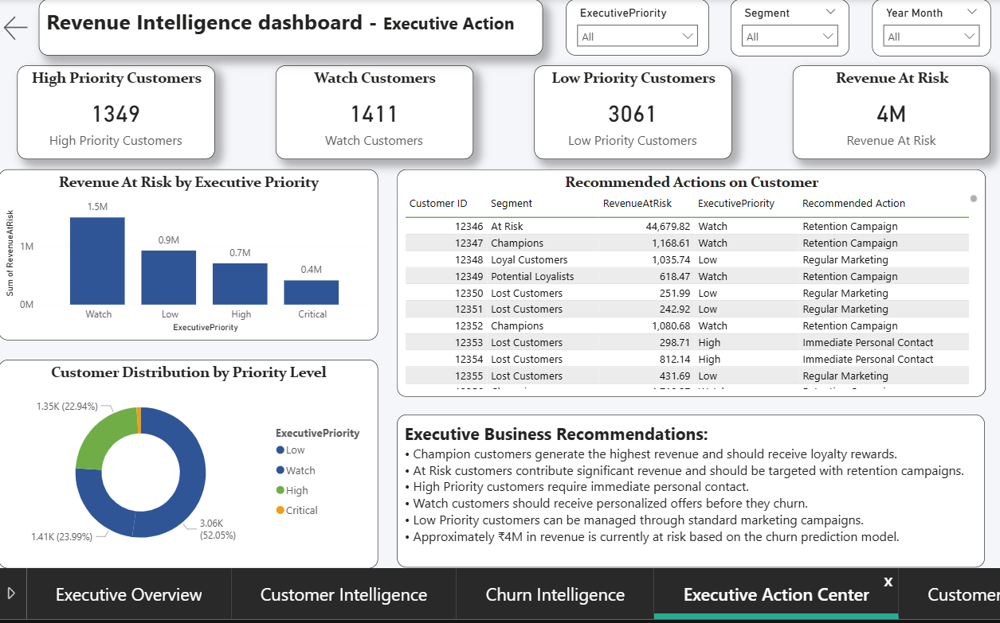

# Revenue-Intelligence-Dashboard
End-to-End Data Analytics &amp; Machine Learning Project using Python, XGBoost and Power BI to predict customer churn, estimate revenue at risk and generate executive business insights.

## Dataset

This project uses the **Online Retail II** dataset from the UCI Machine Learning Repository.

- **Source:** [UCI Online Retail II Dataset](https://archive.ics.uci.edu/dataset/502/online+retail+ii)
- **Original file:** `online_retail_II.xlsx`
- **Records:** 1,067,371 transactions
- **Period:** December 2009 – December 2011
- **License:** Creative Commons Attribution 4.0 (CC BY 4.0)

The original dataset is not included in this repository because of its file size. Please download it from the official source above before running the notebooks.

**Citation:** Chen, D. (2012). Online Retail II [Dataset]. UCI Machine Learning Repository. https://doi.org/10.24432/C5CG6D

## Dashboard Preview

### 1. Executive Overview

### 2. Customer Intelligence

### 3. Churn Intelligence

### 4. Executive Action Center

