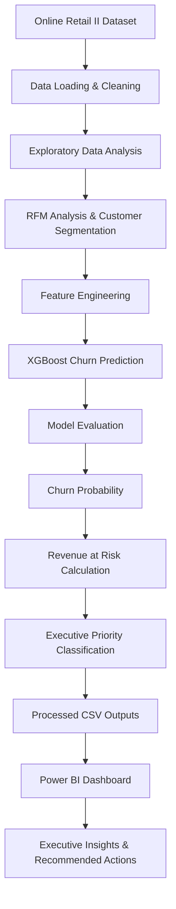

# Revenue-Intelligence-Dashboard
End-to-End Data Analytics &amp; Machine Learning Project using Python, XGBoost and Power BI to predict customer churn, estimate revenue at risk and generate executive business insights.

## Dataset

This project uses the **Online Retail II** dataset from the UCI Machine Learning Repository.

- **Source:** [UCI Online Retail II Dataset](https://archive.ics.uci.edu/dataset/502/online+retail+ii)
- **Original file:** `online_retail_II.xlsx`
- **Records:** 1,067,371 transactions
- **Period:** December 2009 – December 2011
- **License:** Creative Commons Attribution 4.0 (CC BY 4.0)

The original dataset is not included in this repository because of its file size. Please download it from the official source above before running the notebooks.

**Citation:** Chen, D. (2012). Online Retail II [Dataset]. UCI Machine Learning Repository. https://doi.org/10.24432/C5CG6D

## Dashboard Preview

### 1. Executive Overview

### 2. Customer Intelligence

### 3. Churn Intelligence

### 4. Executive Action Center

## Project Architecture

The project follows an end-to-end analytics workflow, starting with raw transaction data and ending with actionable business insights.

## Project Workflow

### 1. Data Preparation
- Loaded and cleaned the Online Retail II transaction dataset.
- Handled missing values and prepared customer-level data.
- Created analytical datasets for further processing.

### 2. Customer Analytics
- Performed Exploratory Data Analysis (EDA).
- Conducted RFM analysis.
- Identified customer segments and purchasing patterns.
- Performed cohort analysis.

### 3. Machine Learning
- Engineered customer-level features.
- Prepared training and testing datasets.
- Developed an XGBoost classification model.
- Evaluated performance using Accuracy, Precision, Recall, F1-score and ROC-AUC.

### 4. Revenue at Risk
- Generated customer-level churn probabilities.
- Estimated revenue at risk.
- Classified customers into executive priority levels.
- Prepared actionable customer-level outputs.

### 5. Power BI Dashboard
- Connected the processed datasets to Power BI.
- Created DAX measures and interactive visualizations.
- Developed four dashboard pages for executive reporting and decision-making.

## Tools & Technologies

| Category | Technologies |
|---|---|
| Programming Language | Python |
| Data Analysis | Pandas, NumPy |
| Data Visualization | Matplotlib, Seaborn, Power BI |
| Machine Learning | XGBoost, Scikit-learn |
| Analytics Techniques | EDA, RFM Analysis, Cohort Analysis |
| Business Intelligence | Power BI, DAX |
| Development Environment | Jupyter Notebook |
| Version Control | GitHub |

## Machine Learning Model Performance

An XGBoost classification model was developed to predict customer churn.

### Evaluation Metrics

| Metric | Result |
|---|---:|
| Accuracy | 73.49% |
| Precision | 71.45% |
| Recall | 79.80% |
| F1-Score | 75.39% |
| ROC-AUC | 79.38% |

### Key Observations

- Achieved 79.38% ROC-AUC on the test dataset.
- Identified approximately 79.80% of actual churn customers (Recall).
- Generated customer-level churn probabilities.
- Combined churn predictions with customer monetary value to estimate revenue at risk.
- Classified customers into executive priority levels to support retention decisions.

## Business Insights & Key Findings

The analysis of 5,881 customers revealed important patterns in customer purchasing behaviour, retention and churn risk.

### 1. Customer Churn
- Identified 2,991 churned customers out of 5,881 customers.
- Observed an overall churn rate of approximately 50.86%, using a 90-day inactivity threshold.
- Identified customer inactivity and purchasing behaviour as important indicators for churn prediction.

### 2. Customer Segmentation
- Used RFM analysis to understand customer purchasing patterns.
- Identified different customer segments, including Champions, Loyal Customers and Lost Customers.
- Distinguished high-value, frequent customers from customers with declining engagement.

### 3. Churn Prediction
- Generated individual churn probabilities using the XGBoost model.
- Used customer-level predictions to identify customers requiring retention attention.
- Evaluated model performance using multiple classification metrics.

### 4. Revenue at Risk
- Combined customer monetary value with predicted churn probability to estimate revenue at risk.
- Categorized customers into Critical, High, Watch and Low priority levels.
- Created a customer-level view to support targeted retention strategies.

## Business Recommendations

| Customer Priority | Recommended Action |
|---|---|
| Critical | Initiate immediate personalized retention outreach |
| High | Offer targeted incentives and exclusive benefits |
| Watch | Monitor purchasing activity and improve engagement |
| Low | Maintain engagement through loyalty campaigns |

The dashboard helps business teams prioritize customer retention efforts, identify potential revenue exposure and make data-driven decisions.

## Project Conclusion

This project demonstrates an end-to-end approach to customer analytics, churn prediction and revenue risk assessment.

By combining Python-based data analysis, customer segmentation, XGBoost machine learning and Power BI visualization, the project transforms raw transaction data into actionable business insights.

The solution helps businesses:
- Understand customer purchasing behaviour.
- Identify customers who are likely to churn.
- Estimate potential revenue exposure.
- Prioritize customer retention activities.
- Support data-driven business decisions through interactive dashboards.

## Future Scope

Potential enhancements to this project include:

- Integrating real-time customer transaction data.
- Automating periodic churn prediction.
- Developing customer-specific retention campaigns.
- Monitoring model performance and prediction drift.
- Integrating the dashboard with automated reporting systems.

## Author

Developed as an end-to-end Data Analytics and Machine Learning portfolio project.

## 🎬 Watch the Interactive Dashboard Demo

Explore how the dashboard transforms customer transaction data into churn insights, revenue-at-risk analysis and actionable business priorities.

▶️ [Watch the Revenue Intelligence Dashboard Demo](Video/Revenue_Intelligence_Dashboard_Demo.mp4)
